# UN Code Sala

Salas de código en tiempo real donde **solo quien crea la sala puede editar** o decidir quién más puede hacerlo. Todos los demás ven los cambios al instante, en solo lectura. Pensada para que un profesor muestre código a una clase de hasta 200 personas.

**En línea:** https://uncodesala-d8ajh8exgzf7c9hs.eastus-01.azurewebsites.net

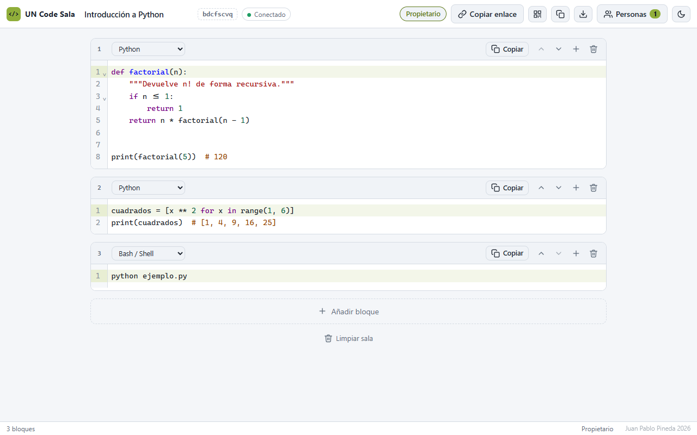

## Características

- Cuaderno de **bloques de código** (hasta 30), cada uno con su lenguaje y su botón **Copiar**.
- 34 lenguajes con resaltado: JavaScript, TypeScript, Python, Java, C, C++, C#, Go, Rust, PHP, SQL, HTML, CSS, Bash y más ([lista](shared/languages.js)).
- Nombre de sala editable por el propietario y **código QR** para entrar desde el celular.
- **Mis salas** en la portada, con el lenguaje del primer bloque y un botón para **eliminar** cada sala.
- **Limpiar sala** elimina todos los bloques de una vez, con un aviso para deshacer.
- Permisos por sala: propietario, editores y espectadores. Un espectador puede **pedir permiso** y el propietario lo concede o lo quita al instante.
- Descargar los bloques, tema claro u oscuro, sin cuentas ni registro.

## Capturas

| | |
| --- | --- |
| **Portada.** Nombre, lenguaje y un clic para crear la sala. | **Invitado.** Solo lectura: puede copiar cada bloque y pedir permiso. |
| 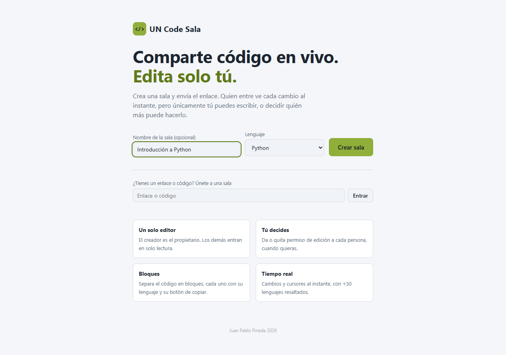 | 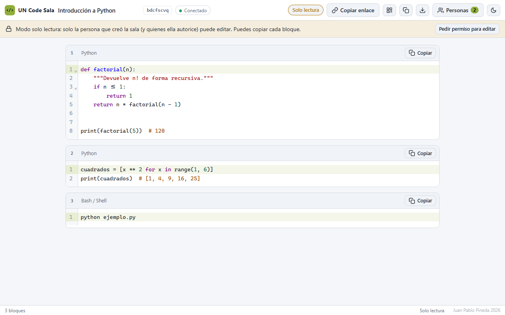 |
| **Personas.** El propietario ve quién está conectado y quién pide editar. | **Código QR.** Para proyectarlo en clase; lleva el enlace de invitados. |
| 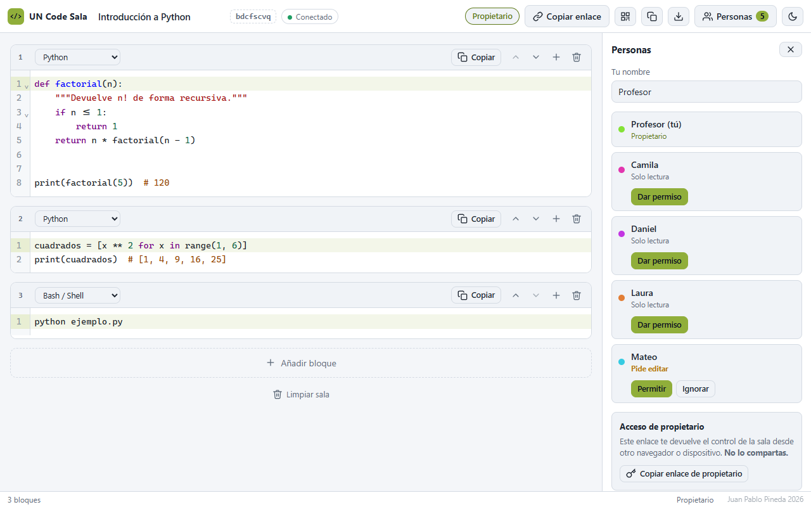 | 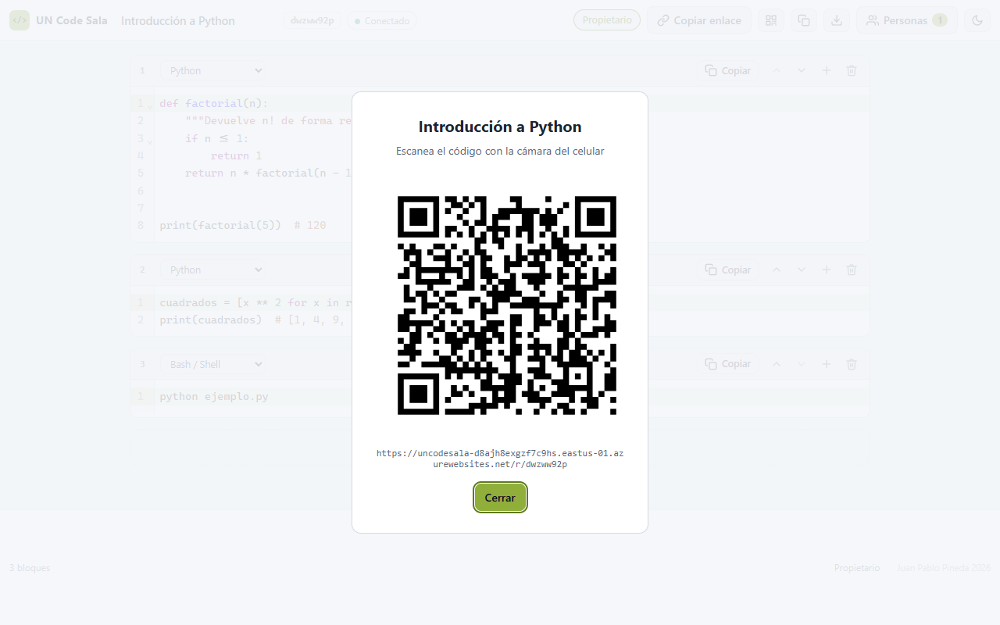 |
| **Tema oscuro.** | **Celular.** |
| 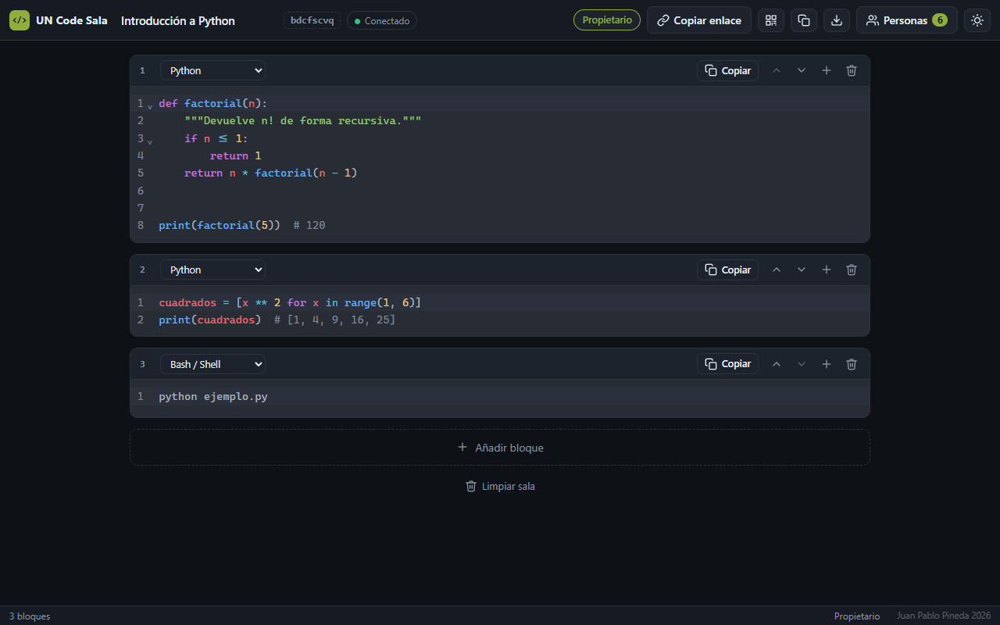 | 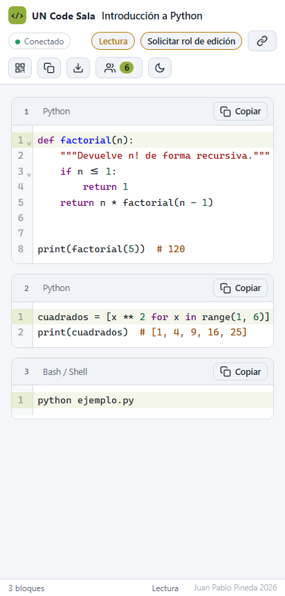 |

## Inicio rápido

Requiere Node.js 20.14 o superior.

```bash
npm install    # instala dependencias y compila el cliente
npm start      # http://localhost:3000
```

1. En la portada elige un nombre (opcional) y un lenguaje, y pulsa **Crear sala**. Quedas como propietario.
2. **Copiar enlace** para invitar en solo lectura, o muestra el **QR**. Ninguno incluye el acceso de propietario.
3. Guarda el **enlace de propietario** (*Personas → Copiar enlace de propietario*). El control vive en tu navegador: sin ese enlace lo pierdes si borras sus datos o cambias de equipo.

## Arquitectura

Un servidor Node.js sirve la interfaz y mantiene los WebSocket. Cada sala es un documento [Yjs](https://yjs.dev) (CRDT) con un mapa de bloques, que el servidor guarda como un JSON por sala.

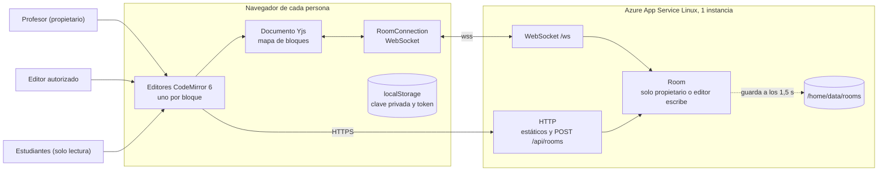

### Flujo 1: crear una sala y entrar

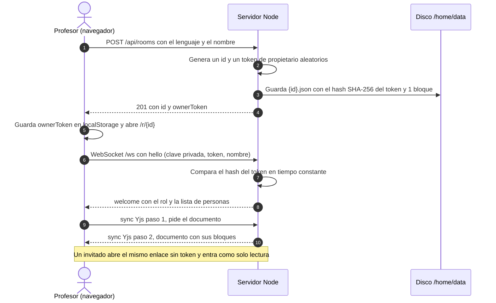

### Flujo 2: edición en tiempo real

Toda escritura se comprueba en el servidor. Si no viene del propietario o de un editor, se descarta, aunque alguien manipule su copia local desde la consola.

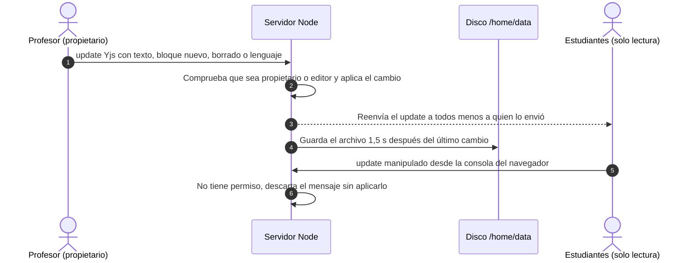

### Flujo 3: pedir, dar y quitar permiso de edición

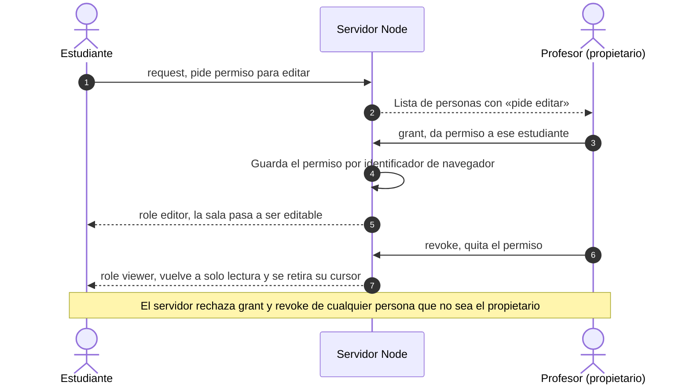

### Flujo 4: entrada de una clase de 200 personas

El servidor agrupa los avisos de entrada y solo el propietario recibe la lista completa; el resto recibe una lista reducida. Sin esto, la lista crecía con el cuadrado de los asistentes.

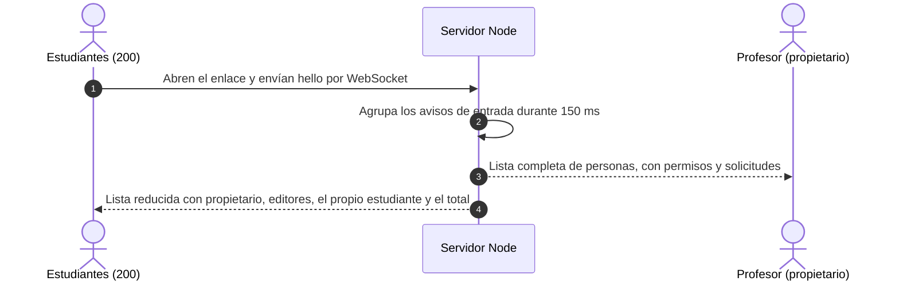

Los mismos diagramas, y el despliegue, están en [`docs/un-code-sala.drawio`](docs/un-code-sala.drawio) (6 páginas, se abre con [draw.io](https://app.diagrams.net)).

## Cómo se garantiza que solo el propietario edita

La regla se aplica **en el servidor**, no en la interfaz.

- Al crear la sala se genera un token de propietario aleatorio; el servidor guarda solo su hash SHA-256 y lo compara en tiempo constante. El enlace de propietario lo lleva en el `#fragmento`, que nunca viaja al servidor.
- Cada navegador tiene una clave privada de la que el servidor deriva un `uid` público. Los permisos se guardan por `uid` y sobreviven a recargas.
- Los mensajes de escritura (`step2`, `update`) de quien no puede editar se descartan, sea texto, un bloque nuevo, un borrado o un cambio de lenguaje.
- Conceder o quitar permisos, renombrar la sala y eliminarla solo lo acepta el servidor si vienen del propietario (eliminar exige su token en `DELETE /api/rooms/{id}`).

Las [pruebas](test/permissions.test.mjs) cubren estos casos, incluido un visitante que manipula su copia local y la envía:

```bash
npm test
```

## Configuración

Variables de entorno opcionales:

| Variable | Por defecto | Descripción |
| --- | --- | --- |
| `PORT` | `3000` | Puerto HTTP |
| `HOST` | `0.0.0.0` | Interfaz de escucha |
| `DATA_DIR` | `./data` | Dónde se guardan las salas (un JSON por sala) |
| `ROOM_TTL_DAYS` | `30` | Las salas sin ediciones durante estos días se borran |
| `MAX_CONNS_PER_ROOM` | `500` | Máximo de personas conectadas a la vez en una sala |
| `TRUST_PROXY` | ninguno | `1` detrás de un proxy inverso, para limitar la creación de salas por IP |

Detrás de un proxy hay que reenviar las cabeceras de WebSocket en `/ws` y servir por HTTPS.

## Capacidad

Medido con [`scripts/loadtest.mjs`](scripts/loadtest.mjs): un profesor escribiendo 10 cambios por segundo y los estudiantes entrando a la vez.

| | 200 estudiantes (local) | 200 estudiantes (Azure B1) |
| --- | --- | --- |
| Conexiones logradas | 200 de 200 | 200 de 200 |
| Cambios perdidos | 0 | 0 |
| Latencia profesor a estudiantes (p95) | 13 ms | 269 a 383 ms |
| Tráfico por estudiante en clase | 0,24 KB/s | 0,24 KB/s |

```bash
npm run loadtest -- --url http://127.0.0.1:3000 --viewers 200
```

No cubre navegadores reales, redes móviles lentas ni muchos estudiantes detrás de una misma IP.

## Azure

La app corre en **Azure App Service (Linux)**. Necesita una sola instancia, porque las salas viven en memoria mientras están abiertas.

### Recursos

Se crean solo dos recursos, en el grupo `codesala-rg` (East US):

| Recurso | Configuración |
| --- | --- |
| Plan de App Service Linux | 1 instancia, nivel **F1** (gratuito) o **B1** (1 núcleo, 1,75 GB) |
| App web | Node 22 LTS, WebSockets activados, solo HTTPS, TLS 1.2, `DATA_DIR=/home/data`, `TRUST_PROXY=1`, `MAX_CONNS_PER_ROOM=300`, *Always On* solo en B1 |

Las salas se guardan en `/home/data`, el disco persistente de App Service: sobrevive a reinicios y a los cambios de plan. No se usa base de datos, registro de contenedores, cuenta de almacenamiento ni Application Insights.

### Por qué cuesta lo que cuesta

- **Lo único que se factura es el plan**, por hora y prorrateado al segundo. La app y su disco no tienen cargo propio, y el tráfico es mínimo (unos 0,6 MB por estudiante al entrar y 0,24 KB/s después).
- **B1 cuesta unos 0,017 USD por hora** (12,41 USD al mes si estuviera encendido todo el mes, según la estimación del portal). Se usa en clase porque F1 no la aguanta: admite unas 3 conexiones WebSocket simultáneas (medido: más allá responde 429), tiene una cuota de CPU diaria y no permite *Always On*.
- **F1 no se factura**, y es donde queda el plan fuera de clase, así que el costo actual es 0 USD.
- **Dos clases de 2 horas a la semana** en B1 son unas 17 horas al mes, alrededor de 0,30 USD.
- El plan **no autoescala**: nunca crece solo ni genera cargos inesperados. Detener la app no detiene el cobro del plan; si algún día se deja en B1, se factura aunque no haya nadie conectado.
- El gasto real se consulta en *Cost Management* del portal (los datos llegan con 8 a 24 horas de retraso). Conviene crear allí un presupuesto de aviso.

### Cambiar de plan

El plan se sube a B1 antes de la clase y se baja a F1 al terminar:

```powershell
.\deploy\clase.ps1 -Modo subir    # F1 a B1, antes de la clase
.\deploy\clase.ps1 -Modo bajar    # B1 a F1, al terminar
```

- **Subir** pasa el plan a B1 y activa WebSockets y *Always On*. **Bajar** desactiva *Always On* (F1 no lo admite) y pasa a F1. En ambos casos el script espera a que la app vuelva a responder.
- Cada cambio tarda unos 40 segundos, y justo después Azure sustituye el contenedor: la app puede dar 503 durante uno o dos minutos. Sube el plan **5 a 10 minutos antes** de que lleguen los estudiantes y abre la sala en ese momento.
- La dirección no cambia y las salas se conservan. Con un dominio propio no se podría volver a F1, que no los admite.
- **No olvides bajar el plan** al terminar.

Lo mismo con la CLI de Azure:

```powershell
az appservice plan update -g codesala-rg -n <plan> --sku B1
az webapp config set -g codesala-rg -n <app> --web-sockets-enabled true --always-on true
```

Para bajar: primero `--always-on false` y luego `--sku F1`. En el portal: *Plan de App Service → Escalar verticalmente*.

### Publicar cambios

```powershell
.\deploy\azure.ps1 -AppName <nombre> -Location <región>   # primera vez: crea plan y app, y publica
.\deploy\publicar.ps1                                       # publicar cambios
```

`publicar.ps1` compila en tu equipo, sube un zip de 2,5 MB con la API de archivos de Kudu, reinicia la app y espera a que `/version` devuelva la versión nueva. No se usa `az webapp deploy`: su tubería de Kudu se colgaba con HTTP 502. Más detalles en [`deploy/AZURE.md`](deploy/AZURE.md).

## Estructura

```
server/    Servidor HTTP + WebSocket y lógica de salas, permisos y persistencia
client/    Editor (CodeMirror 6 + Yjs), conexión en tiempo real y portada
public/    HTML, CSS y recursos estáticos
shared/    Lista de lenguajes compartida
test/      Pruebas de permisos
scripts/   Prueba de carga
deploy/    Scripts y guía de Azure App Service
docs/      Diagramas (un-code-sala.drawio), flujos en Mermaid y capturas
```

Desarrollo del cliente con recompilación automática: `node build.mjs --watch`.

## Límites conocidos

- Un editor autorizado puede borrar todo el contenido; no hay historial de versiones.
- Las salas se guardan en disco sin cifrar y cualquiera con el enlace puede leerlas: no pegues secretos.

## Licencia

[MIT](LICENSE) © 2026 Juan Pablo Pineda
